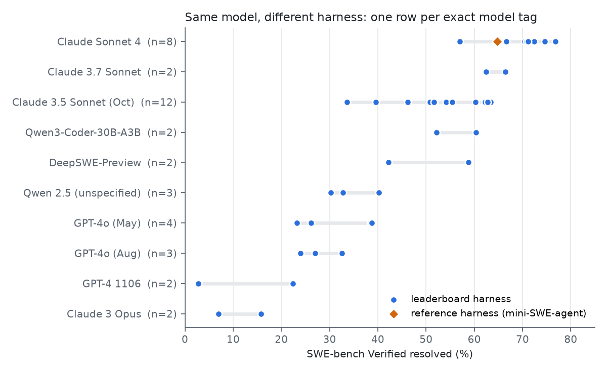
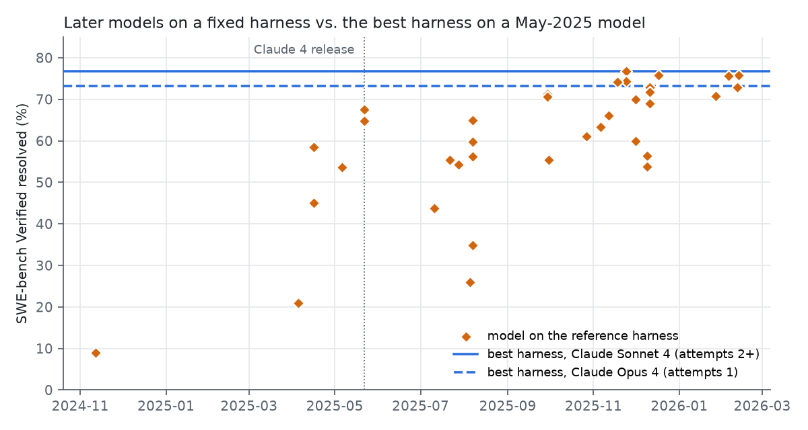

# What is a harness worth? Paired, per-instance evidence from the public SWE-bench Verified record

**Same model, different harness: most of the differences on the public record are real, the model still moves the score more, and for open-weight models the harness gap is widest.**

Ilpo Väätäinen, independent researcher

---

## Abstract

This competition assumes that a better agent around an open model closes much of its gap to cloud models. We test this on the public SWE-bench Verified record (Jimenez et al., 2024). Every submission is scored on the same 500 instances and publishes which it resolved, so any two submissions can be compared with an exact paired test.

We compare, with pre-registered hypotheses, **(A)** 40 leaderboard submissions sharing one of 10 exact model tags (111 same-model pairs) with **(B)** 38 complete runs of the reference harness mini-SWE-agent, rebuilt from 18,968 per-instance reports.

- **H1, supported:** 68 of 111 same-model harness pairs (61 %) differ after Holm correction (expected ≥ 50 %); median gap 8.2 points.
- **H3, supported:** 11 of 24 (46 %) among single-attempt submissions (expected ≥ 1/3).
- **H2, supported but fragile:** for 4 of 7 models, a leaderboard harness beats the reference harness by ≥ 5 points, separably.
- **Exploratory:** with exact tags, the harness SD is 0.39 of the model SD (family grouping inflates this to 0.62–0.67). For the open-weight Kimi K2 the same weights score 43.8–65.4 % across harnesses.

We release `paircheck.py`, which reports whether a claimed improvement is distinguishable from noise and the smallest gap the comparison could have detected.

---

## 1. Why this question, and what is already known

**The question.** The competition bets on two levers: the model, and everything around it — the *harness*: tools, prompts, retrieval, retries, test-time budget (Yang et al., 2024). Which lever moves SWE-bench scores more decides where a small team should spend its effort.

**Earlier work on the same question:**

- **Holistic Agent Leaderboard** (Kapoor et al., arXiv:2510.11977): reports cross-scaffold gaps of 34 to nearly 48 points for frontier models under two scaffolds, larger than the cross-model spread under either scaffold.
- ***Stop Comparing LLM Agents Without Disclosing the Harness*** (arXiv:2605.23950) builds on those numbers.
- ***The Scaffold Effect in Coding Agents*** (arXiv:2607.22585): measures paired within-model pass-rate differences of 0 to 8 points across three harnesses, and up to 40× differences in tokens per solved task.

That the harness matters is therefore established. We do not claim it as new.

**What this paper adds:**

1. **The harness gaps actually on the public leaderboard.** Instead of two or three scaffolds chosen by the authors, we use every leaderboard submission that names a single model (64 of 135). That includes 12 submissions on Claude 3.5 Sonnet and 8 on Claude Sonnet 4.
2. **Exact paired tests on per-instance outcomes.** These show which of those gaps are distinguishable from noise and which are not.
3. **A calendar reading.** How long models on a fixed reference harness took to reach a model's leaderboard harness.

**How this relates to the controlled studies.** On the leaderboard, the model accounts for more of the spread than the harness (SD ratio 0.39). A possible, untested reconciliation with the 34–48-point controlled gaps: the leaderboard lacks the weak harnesses a generalist-vs-specialist comparison includes.

**Our earlier work.** Väätäinen (Zenodo 10.5281/zenodo.22541065) tested whether adjacent ranks can be told apart on five public leaderboards, SWE-bench Verified among them. It contains no harness analysis.

## 2. Data

### A. The leaderboard (fixed model)

- **Source.** SWE-bench/experiments, pulled 2 November 2026 (commit 40f164d). 135 Verified submissions publish their resolved instance IDs.
- **Parity check.** Rebuilt rates match the official leaderboard within 0.2 points for all 133 submissions on it (two are not on it); `harness_a.py` aborts on a mismatch.
- **Model identity** comes from each submission's `metadata.yaml`:
  - 64 list exactly one model;
  - 25 list several;
  - 46 list none.
- **Tag normalisation.** Only word order, separators and date format (`claude-4-sonnet-20250514` = `claude-sonnet-4-20250514`); different dated snapshots are never merged.
- **Groups used.** 10 exact tags have at least two submissions, covering 40 submissions.
- **Data-quality flags** (added after an independent review; §3):
  - two submissions carry a tag naming a model snapshot released *after* the submission date (e.g. a June-2024 SWE-agent run tagged with the October-2024 Claude 3.5 Sonnet);
  - four are retrieval (RAG) baselines, not agents;
  - the tag "Qwen 2.5" covers three submissions on different models.

### B. The reference harness (fixed harness)

- **Source.** mini-SWE-agent is the minimal harness the SWE-bench maintainers use for the bash-only board. Per-instance `report.json` files come from the public bucket `s3://swe-bench-submissions/bash-only/` (55 runs).
- **Inclusion rule** (a logged deviation, added after we found the bucket incomplete): a run needs at least 490 reports, and its rebuilt rate must match the published one within 0.2 points.
- **38 runs pass.** Excluded:
  - 10 incomplete in the bucket (one has 98 of 500 reports);
  - 3 without metadata;
  - 4 whose rebuilt rate differs by 0.4–1.6 points.
- **Harness version.** It varies across runs (v0.0.0 to v2.0.0), and some runs use "high" reasoning settings. "Fixed harness" therefore means one harness family, not one frozen version.
- **Contamination flag.** 14 of the 38 runs ship a `git_peek_suspicious_commits.md`, listing 59 distinct instances where a trajectory read repository history it should not have. Every B-side test is repeated with those instances removed. No such flags exist for leaderboard submissions, so side A is not screened.

## 3. Method

**Paired test.** With *n_ab* the instances only *a* resolves and *n_ba* those only *b* resolves, the exact McNemar test (McNemar, 1947) is a two-sided binomial test of *n_ab* out of *n_ab + n_ba* at p = 0.5. Instances both resolve or both miss carry no information about which is better; comparing marginal rates instead discards the pairing and loses power. Holm correction at α = 0.05 within each family of tests (Holm, 1979).

**Self-checks.** The analysis aborts if any of these fails:

- a submission tested against itself gives p = 1;
- 60 flipped instances planted in the top submission are detected (p = 1.7 × 10⁻¹⁸);
- the leaderboard parity check above.

**Pre-registration.** `PREREG_original.md` (sha256 `30159dfe…`, recorded 2 November 2026 15:53 UTC) states four hypotheses and their thresholds. It was written before any result was computed. The appendices of `PREREG.md` log two deviations:

1. The B inclusion rule, written after the A results existed. It concerns B only.
2. Written after all results, following an independent review. It covers:
   - the data-quality flags;
   - the fact that H2 also uses model tags with a single leaderboard submission (Data A specified groups of ≥ 2);
   - a float-tolerance fix that moved one run into B.

Everything marked *exploratory* or *sensitivity* below was not pre-registered.

## 4. Results

### 4.1 H1: same model, different harness

*Figure 1. Every leaderboard submission on each exact model tag with at least two submissions (blue dots). Only Claude Sonnet 4 also has a complete reference-harness run (orange diamond).*

**Result.** Of 111 within-model pairs, **68 (61.3 %) are separable after Holm**; 85 have raw p < 0.05. The pre-registered expectation was at least 50 %: **supported.**

- Median absolute difference: 8.2 points.
- Largest non-separable difference: 6.6 points.

**Sensitivity (exploratory).** Removing the flagged rows (date-impossible tags, RAG baselines, the mixed "Qwen 2.5" tag) leaves 93 pairs in 7 models. Of these, **52 (55.9 %)** are separable, so the result holds.

| model (exact tag) | submissions | best | median | worst | spread |
|---|---:|---:|---:|---:|---:|
| Claude Sonnet 4 (20250514) | 8 | 76.8 | 71.0 | 57.0 | 19.8 |
| Claude 3.7 Sonnet (20250219) | 2 | 66.4 | 64.4 | 62.4 | 4.0 |
| Claude 3.5 Sonnet (20241022) | 12 | 63.4 | 53.0 | 33.6 † | 29.8 |
| Qwen3-Coder-30B-A3B | 2 | 60.4 | 56.3 | 52.2 | 8.2 |
| DeepSWE-Preview | 2 | 58.8 | 50.5 | 42.2 | 16.6 |
| "Qwen 2.5" † | 3 | 40.2 | 32.8 | 30.2 | 10.0 |
| GPT-4o (2024-05-13) | 4 | 38.8 | 32.3 | 23.2 | 15.6 |
| GPT-4o (2024-08-06) | 3 | 32.6 | 27.0 | 24.0 † | 8.6 |
| GPT-4 1106-preview | 2 † | 22.4 | 12.6 | 2.8 | 19.6 |
| Claude 3 Opus (20240229) | 2 † | 15.8 | 11.4 | 7.0 | 8.8 |

*SWE-bench Verified resolved, %. † = row or value affected by a data-quality flag (§2).*

The widest rows: on Claude 3.5 Sonnet, eleven correctly tagged submissions span 23.8 points (the 33.6 % run is the date-impossible tag); on Claude Sonnet 4, eight span 19.8. DeepSWE and Qwen3-Coder-30B each compare one agent with and without test-time scaling; the GPT-4 1106 and Claude 3 Opus rows compare a RAG baseline with an agent.

### 4.2 H3: the attempts confound

Some submissions report best-of-several attempts (`attempts: 2+`), which inflates their score relative to single-attempt runs.

**Result.** Restricted to pairs where both submissions used one attempt, **11 of 24 (45.8 %) are separable**, in 4 models. The pre-registered expectation was at least one third: **supported.**

- Median difference: 4.4 points.
- Largest non-separable difference: 4.6 points.
- With flagged rows also removed: 9 of 22 (40.9 %).

### 4.3 How large is the harness relative to the model? (exploratory)

Variance decomposition over exact tags, using only groups with at least two submissions *after* each filter:

| grouping | submissions | groups | between-model SD | within-model SD | ratio |
|---|---:|---:|---:|---:|---:|
| exact tag, all | 40 | 10 | 17.9 | 6.9 | **0.39** |
| exact tag, single attempt | 13 | 4 | 16.4 | 6.3 | 0.38 |
| exact tag, flagged rows removed | 31 | 7 | 13.8 | 6.2 | 0.45 |
| regex *family* (our August method), same data | 59 | 13 | 18.1 | 11.3 | 0.62 |

**Family grouping inflates the harness share**: pooling, say, all "claude-4" models counts size and snapshot differences as harness spread (0.62; 0.67 on single-tag submissions, the figure in our earlier repository analysis). With exact tags the within-model SD is 0.4–0.45 of the between-model SD.

The ratio is specific to this sample (models with ≥ 2 harnesses, released over two years) and is a ratio of SDs (variance ratio ≈ 0.15).

**The mirror-image test on B.** On B (fixed harness, different models), 472 of 703 pairs (67.1 %) are separable. The median difference is 11.8 points.

### 4.4 H2: what a leaderboard harness adds on top of the reference harness

Seven exact model tags have both a leaderboard submission and a complete reference-harness run. For five of them there is only one leaderboard submission, so "best leaderboard harness" means "the only one".

| model | leaderboard harness | n | reference harness | gap | p | gap, flagged removed | later runs below |
|---|---:|:-:|---:|---:|---:|---:|---:|
| Claude Sonnet 4 | 76.8 (2+ attempts) | 8 | 64.8 | **+12.0** | < 10⁻⁴ | +11.3 | 30 / 31 |
| ″ best single attempt | 74.6 | | 64.8 | **+9.8** | < 10⁻⁴ | | |
| Kimi K2 Instruct | 53.4 | 1 | 43.8 | **+9.6** | < 10⁻⁴ | +9.5 | 2 / 30 |
| GPT-5 (20250807) | 71.8 | 1 | 65.0 | **+6.8** | < 10⁻⁴ | +7.7 | 13 / 23 |
| Claude Opus 4 | 73.2 | 1 | 67.6 | **+5.6** | 0.003 | +5.0 (4.99) | 25 / 31 |
| Claude Opus 4.5 (20251101) | 79.2 | 1 | 74.4 | +4.8 | 0.0005 | +5.4 | 13 / 13 |
| Gemini 3 Pro preview | 77.4 | 1 | 74.2 | +3.2 | 0.014 | +3.4 | 15 / 15 |
| Claude Opus 4.5 (undated tag) | 79.2 | 1 | 76.8 | +2.4 | 0.10 | +1.8 | 13 / 13 |

*Resolved, %. "Gap, flagged removed" is computed over the 441 instances that no reference-harness run flagged. "Later runs below" counts reference-harness runs of later-released models that score below the leaderboard harness.*

**Pre-registered criterion.** A gap of at least 5 points that is separable, for at least half of the models. **Met for 4 of 7: supported.** Six of the seven gaps are separable.

**The result is fragile.** With the git-peek-flagged instances removed, the count is still 4 of 7, but the membership changes: Claude Opus 4 falls to 4.99 points and the dated Claude Opus 4.5 rises to 5.4. Two of the four qualifying gaps sit within a point of the threshold.

*Figure 2. Every complete reference-harness run by model release date (orange), against the leaderboard harness on Claude Sonnet 4 and Claude Opus 4 (blue lines). Both models were released in May 2025.*

**Calendar reading (exploratory).** Claude Opus 4's leaderboard harness is its only one: Anthropic's own single-attempt run, 73.2 %.

- Of 31 reference-harness runs of later-released models, 25 score below it.
- Counted per model tag rather than per run, 22 of 28.
- On this record, no reference-harness run reached 73.2 % until Gemini 3 Pro preview, released 18 November 2025, six months after Claude Opus 4.

This is not a controlled comparison: the reference harness is deliberately minimal, its versions changed, and some later runs use high reasoning settings.

### 4.5 H4: the reference-harness board itself

**Result.** On the reference-harness board, only **4 of 37 adjacent ranks** are separable after Holm (3 of 37 with the flagged instances removed). No direction was pre-registered.

Neighbouring ranks are rarely distinguishable here either, with the harness family held fixed (its version and reasoning settings vary).

## 5. What this means for an open-model coding agent

**1. For open-weight models, the harness gap on the record is widest.**
- Kimi K2 (open weights):
  - reference harness: 43.8 %;
  - a SWE-agent-based leaderboard harness: 53.4 % (+9.6, p < 10⁻⁴);
  - OpenHands on the July `kimi-k2-0711-preview` tag: 65.4 %. Our pre-registered rule does not merge different tag strings, but this is very likely the same weights. Measured exploratorily, the gap is +21.6 points (p ≈ 5 × 10⁻²⁴).
- Devstral Small, a model small enough for a single consumer GPU:
  - May 2025 snapshot under OpenHands: 46.8 %;
  - July 2025 snapshot under SWE-agent: 38.0 %;
  - December 2025 snapshot on the reference harness: 56.4 %.
  These are different snapshots, so this is not a paired comparison.
- Closed frontier models show 2–7-point gaps (Claude Sonnet 4 excepted).

**2. The harness does not replace the model.** The model's SD is 2.2–2.6 times the harness's; a 20-point deficit will not close through harness work alone. On the minimal harness, the best open-weight models are already close (MiniMax 2.5 75.8 %, GLM-5 72.8 %, best closed 76.8 %).

**3. Test a harness claim before believing it.**
- About two in five same-model harness differences on the public record are not distinguishable from noise, including differences up to 6.6 points.
- Below 3 points, only 1 of 21 within-model pairs was separable. With flagged rows removed, 0 of 20.
- Following Card et al. (2020), we recommend that agent papers report, next to "+X points", the exact paired p-value and the smallest gap their comparison could have detected. `paircheck.py` computes both. For example, our largest H2 gap (76.8 % vs 64.8 %, 68 against 8 discordant instances) could have detected a gap of 4.0 points.

## 6. Limitations

- **Tags.** Self-reported and not checked against trajectories; two are date-impossible, and the same weights sometimes appear under different strings (Claude Opus 4.5; Kimi K2), so some real pairs go unused.
- **Not causal.** Harnesses arrive at different times with different budgets; the reference harness changed version. H2 uses each model's best reference run (conservative for the gap).
- **Coverage.** 17 of 55 bash-only runs are unusable (listed in `results/b_runs.csv`). One benchmark, 500 instances: gaps below about 3 points are rarely resolvable. The public per-instance record ends in early 2026 (latest reference-harness logs: February 2026); newer models, including the Claude 5 family, have no per-instance submissions and could not be tested.

## 7. Reproducibility and resource

Public data, a laptop, a few minutes after a one-off ~280 MB download.

1. Data: sparse clone of SWE-bench/experiments (`results.json`), `leaderboards.json` from swe-bench.github.io, and `sh fetch_bashonly.sh` (public bucket).
2. `python harness_a.py` (H1, H3, parity, flags) → `python harness_b.py` (H2, H4, git-peek sensitivity) → `python explore.py` → `python fig.py`; outputs in `results/`.
3. `python paircheck.py A B`: p-value and detectable gap for any two submissions.

- **Pre-registration:** `PREREG_original.md` (hash in `PREREG.sha256`); deviations appended in `PREREG.md`.
- **Environment:** Python 3.14, numpy, pandas, scipy, PyYAML, matplotlib.
- **Data licences:** follow the SWE-bench repositories'.

## Acknowledgements and disclosure

The SWE-bench maintainers publish per-instance results; none of these tests is possible without that. An independent review of the draft found errors corrected here (a mislabelled submission, a variance-ratio bug, a parity float artefact); see `PREREG.md`, Deviation 2. This work was carried out with AI assistance for code, analysis and drafting; the author takes responsibility for the content.

## References

- Card, D., Henderson, P., Khandelwal, U., Jia, R., Mahowald, K., Jurafsky, D. (2020). With Little Power Comes Great Responsibility. *EMNLP 2020*. arXiv:2010.06595.
- Holm, S. (1979). A simple sequentially rejective multiple test procedure. *Scandinavian Journal of Statistics* 6, 65–70.
- Jimenez, C. E., et al. (2024). SWE-bench: Can Language Models Resolve Real-World GitHub Issues? *ICLR 2024*.
- Kapoor, S., et al. (2025). Holistic Agent Leaderboard. arXiv:2510.11977.
- McNemar, Q. (1947). Note on the sampling error of the difference between correlated proportions or percentages. *Psychometrika* 12, 153–157.
- *Stop Comparing LLM Agents Without Disclosing the Harness* (2026). arXiv:2605.23950.
- *The Scaffold Effect in Coding Agents* (2026). arXiv:2607.22585.
- Väätäinen, I. (2026). How Much of a Leaderboard Ranking Survives Its Own Sampling Error? A Paired-Resolution Audit of Five AI Benchmarks. Zenodo, 10.5281/zenodo.22541065.
- Yang, J., et al. (2024). SWE-agent: Agent-Computer Interfaces Enable Automated Software Engineering. *NeurIPS 2024*.
